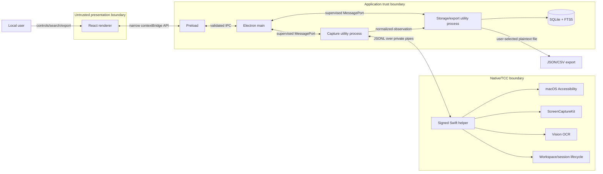
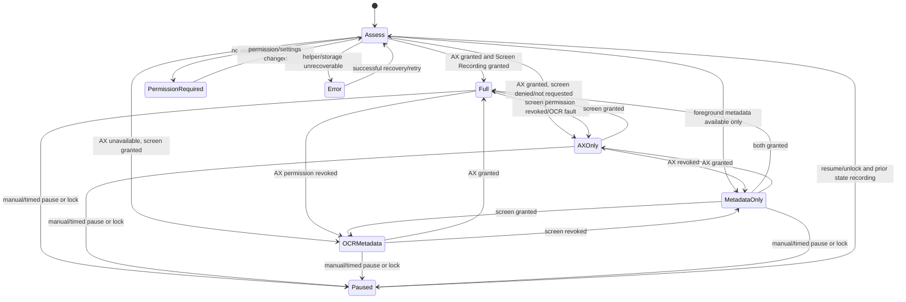
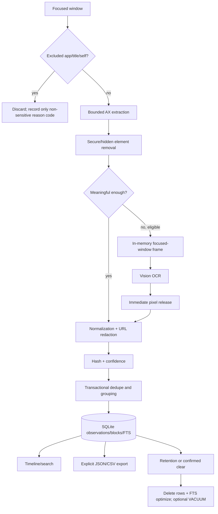

# AmbiantMemory — Privacy-First macOS Activity Journal HLD and LLD

Status: design approved for implementation planning; no implementation is included here.  
Target: macOS 13 Ventura or later, Apple silicon and Intel, distributed outside and optionally through the Mac App Store only after sandbox feasibility is separately validated.  
Architecture: Electron + React + TypeScript, standalone Swift helper, SQLite.

## 1. Assumptions and resolved decisions

### Product assumptions

1. The journal has one local macOS user and one local database. It does not synchronize between Macs in v1.
2. The minimum supported OS is macOS 13. ScreenCaptureKit behavior and Vision quality are tested on every supported major OS version.
3. The app records only foreground-work context. It does not infer whether the user is physically present beyond lock/session-active signals and does not collect input events.
4. A timeline block may contain sensitive text exposed incorrectly by another application's Accessibility tree. The product makes that residual risk explicit during onboarding and provides exclusions, pause, retention, and deletion controls.
5. Searchable extracted text is retained until the configured retention period expires. Default retention is unlimited because silent deletion is surprising; onboarding calls this out and offers 7, 30, 90 days, or unlimited.
6. Capture resumes after unlock only if it was recording before lock. A manual or timed pause survives sleep, helper restart, and Electron restart.
7. The product does not claim exact time tracking. It reports best-effort intervals and visually distinguishes gaps and low-confidence blocks.
8. JSON and CSV export are explicit user actions, write only to a user-selected path, and warn that exports are plaintext.

### Technical decisions

| Decision | Selected default | Rationale |
|---|---|---|
| Native integration | Signed standalone Swift helper using newline-delimited JSON (JSONL) over private stdin/stdout pipes | Small language boundary, process isolation, independent testing, easier crash recovery, and no Node ABI coupling. |
| Native protocol | Versioned request/response/events; strict JSON Schema validation in Electron | Makes compatibility and malformed-data handling explicit. |
| SQLite library | `better-sqlite3` in a dedicated Electron utility process | Simple transactions and FTS5 support; utility process keeps synchronous DB work off main/renderer. Native module is rebuilt and signed for Electron. |
| Heavy TypeScript work | Dedicated capture utility process; DB/export in a separate storage utility process | Protects the Electron main event loop and isolates captured content from the renderer until requested. |
| OCR | Vision inside the Swift helper; no image bytes cross the helper boundary | Strong screenshot-lifetime invariant and reuses Vision resources. |
| Search | SQLite FTS5 external-content table over observation text and block labels/titles/URLs | Fast local search without another index service. |
| Database encryption | Not in v1; rely on FileVault and macOS file permissions | SQLCipher adds packaging, migration, key-management, and FTS complexity. An encrypted-v2 ADR must define key loss/recovery and conversion. |
| Window identity | Ephemeral composite `(pid, CGWindowID when available, AX identifier/title/bounds fingerprint, activation epoch)` | No single identifier is reliable across all apps; activation epoch prevents accidental cross-session merging. |
| Activity grouping | Deterministic subject-key normalization with a two-minute maximum gap | Reproducible, explainable, and testable without an LLM. |
| Structured AX elements | Off by default; when enabled, store only the privacy-filtered bounded subset | Minimizes data while permitting diagnostics/research with explicit consent. |
| Logs | Metadata-only structured logs with allowlisted fields and rotating local files | Captured text, titles, URLs, hashes derived from content, and AX values never enter logs. |
| Distribution | Developer ID signed/notarized DMG first | Hardened runtime and stable signing identity are important for TCC permissions. App Store sandboxing is a separate feasibility track. |

### Open product decisions (do not block the architecture)

- Confirm minimum macOS version and whether Mac App Store distribution is required. Default: macOS 13+, notarized direct download.
- Confirm default retention. Recommended: unlimited with a prominent onboarding choice; never silently delete data.
- Confirm whether browser URLs should be stored in full. Recommended: store origin plus privacy-filtered path by default; drop query and fragment. Allow full URL only as an opt-in setting.
- Confirm whether structured AX elements are a user-visible advanced option. Recommended: disabled in v1.
- Confirm whether idle time based on system idle duration is desired later. It is excluded from v1 because the stated product only authorizes session-active signals, not input monitoring.

None of these choices changes the process boundaries or protocol.

## 2. High-Level Design

### System context and trust boundaries

The user controls capture from a menu bar UI. Electron owns lifecycle, policy, settings, timeline presentation, and orchestration. A signed child helper is the only component allowed to call macOS Accessibility, ScreenCaptureKit, Vision, and native session APIs. SQLite and exports remain local.



The renderer is treated as potentially compromised: no Node integration, context isolation on, sandbox on, a restrictive CSP, no remote content, no navigation, and no raw database/native bridge. Preload exposes immutable, purpose-specific methods. Main validates every request and response. Helper stdout is protocol-only; diagnostic logs go to stderr with redaction.

### Components and responsibilities

- **Electron main:** single-instance lock, tray/menu/window lifecycle, permission UI orchestration, utility-process and helper supervision, power/lock events, safe file dialogs, IPC authorization, and application state.
- **Capture utility process:** adaptive scheduler, event coalescing, exclusions, AX/OCR selection, normalization, deduplication, confidence calculation, and block aggregation commands. It owns no UI.
- **Storage/export utility process:** SQLite connection, migrations, transactions, FTS maintenance, retention, timeline/search queries, and streaming export. It serializes writes.
- **Swift helper:** TCC permission calls, foreground/focused-window metadata, bounded AX traversal, AXObserver event production, focused-window in-memory capture, Vision recognition, and native session/display events. It remains stateless except for observers, short-lived OCR/hash caches, and protocol session state.
- **Preload:** typed facade with no generic `send`, filesystem, shell, process, or arbitrary channel APIs.
- **React renderer:** status/menu-adjacent views, onboarding, settings, timeline, search, diagnostics summary, and confirmations. It receives only paginated records requested for display.
- **Repositories:** persistence APIs and transactions, not business policy.
- **Diagnostics:** metadata-only health ring buffer and persisted diagnostic events; never captured content.

### End-to-end capture flow

```mermaid
sequenceDiagram
  participant OS as macOS/AXObserver
  participant H as Swift helper
  participant C as Capture process
  participant S as Storage process
  participant DB as SQLite
  OS->>H: focus/value/title/session event
  H-->>C: coalescible event (no captured text)
  C->>C: debounce 750 ms; check state/exclusions
  C->>H: getActiveWindow
  H-->>C: stable window token + metadata
  C->>H: getAccessibilitySnapshot(token, bounds)
  H-->>C: filtered bounded AX snapshot + quality
  C->>C: normalize, privacy-filter, score, hash
  alt AX meaningful
    C->>S: commit observation candidate
  else OCR eligible and permitted
    C->>H: captureAndRecognizeActiveWindow(token)
    H->>H: capture in memory, verify token, OCR, release pixels
    H-->>C: OCR text + metadata, never pixels
    C->>S: commit combined/OCR candidate
  else metadata available
    C->>S: commit metadata-only candidate
  end
  S->>DB: one transaction: dedupe + block + FTS
  DB-->>S: committed IDs/state
  S-->>C: commit result
```

Each capture revalidates the active window after expensive AX/OCR work. If the token changed, the result is discarded rather than attributed to the wrong window. Timestamps use wall clock for persistence and monotonic time for intervals, debounce, and timeout calculations.

### Permission and degraded-mode state machine



Screen Recording is requested only when OCR fallback is enabled and useful; the app can operate AX-only without it. Permission prompts are user-initiated. The UI deep-links to System Settings where supported, then polls permission state with backoff. Revocation is detected before capture and after native authorization failures.

### Data lifecycle



### Deployment and packaging

The app bundle contains Electron resources, the signed Swift helper at `Contents/Helpers`, and Electron utility-process entry points in the application archive. Build order is: compile universal helper, test, sign helper with hardened runtime and required entitlements, package Electron, sign nested code from the inside out, sign the app, notarize, staple, and verify with `codesign`, `spctl`, and a clean-machine permission test. The app and helper share a stable designated requirement across upgrades. Development builds use a stable locally signed bundle identifier to avoid repeated TCC invalidation; unsigned hot-rebuilds are documented as permission-destructive.

The helper is spawned only by main/capture infrastructure using an absolute path inside the verified bundle, with a scrubbed environment and private pipes. It accepts no socket connections or file paths. Parent-death detection and an authentication nonce in the initial handshake reduce accidental attachment; code-signature validation is added if a future transport is externally reachable.

### Major risks and mitigations

| Risk | Mitigation |
|---|---|
| Sensitive values mislabeled as non-secure by apps | Exclusions before traversal, secure-role suppression, conservative role/value allowlist, URL query removal, short previews, warning, pause, deletion, and privacy regression tests. |
| Wrong-window attribution after focus race | Window token captured before work and revalidated afterward; mismatches are discarded. |
| TCC permissions lost on rebuild/upgrade | Stable bundle IDs/signing requirements, direct-distribution test matrix, clear status and recovery guidance. |
| AX hangs or huge trees | Per-call and whole-traversal deadlines, maximum depth/nodes/text bytes, cancellation, helper isolation, cooldown per app. |
| OCR CPU/privacy cost | Only focused-window capture, memory-only buffers, perceptual/content hashes, 10-second/window limit, stable-screen backoff, thermal/power-aware suppression. |
| Renderer compromise | No Node, sandbox, CSP, local-only assets, validated narrow IPC, no SQL/native/file primitives. |
| Helper crash loop | Exponential restart with jitter and circuit breaker; metadata mode remains available where possible. |
| Database corruption or migration failure | WAL, integrity checks, backup-before-destructive migration, transactional migrations, fail closed and preserve original file. |
| Unbounded data/memory | Bounded queues/caches/payloads, pagination, streaming exports, retention job, resource metrics. |

## 3. Low-Level Design

### Repository/package structure

```text
apps/desktop/
  src/main/              # lifecycle, tray, windows, IPC router, supervisors
  src/preload/           # contextBridge facade and public types
  src/renderer/          # React views and state
  src/capture/           # utility entry, scheduler, normalization, policy, grouping
  src/storage/           # utility entry, migrations, repositories, FTS, export
packages/
  contracts/             # TypeScript types, JSON Schemas, validators, protocol fixtures
  domain/                # observations, blocks, labels, confidence, pure algorithms
  config/                # defaults and settings schema
native/macos-helper/
  Sources/Protocol/      # envelopes, codec, router, error mapping
  Sources/Permissions/   # AX and screen permission services
  Sources/Windowing/     # foreground/window identity and token validation
  Sources/Accessibility/ # traversal, observers, filtering
  Sources/OCR/           # ScreenCaptureKit, hashes, Vision, buffer lifetime
  Sources/Lifecycle/     # lock, unlock, sleep, wake, displays
  Tests/
tests/contract-fixtures/
docs/adr/
```

### Domain interfaces

```ts
type CaptureSource = "accessibility" | "ocr" | "combined" | "metadata_only";

interface WindowToken {
  pid: number;
  cgWindowId?: number;
  axIdentifier?: string;
  activationEpoch: string;
  fingerprint: string; // opaque helper-produced identity; not persisted in logs
}

interface ObservationCandidate {
  capturedAt: string;             // RFC 3339 UTC
  monotonicSequence: number;
  app: { bundleId: string; name: string };
  window: { token: WindowToken; title?: string; documentTitle?: string; url?: string };
  normalizedText: string;
  source: CaptureSource;
  quality: number;                // [0,1]
  contentHash: string;            // keyed BLAKE3/SHA-256, DB-local key
  subjectKey: string;
  structuredElements?: AXElementSummary[];
}

interface CapturePolicy {
  eventDebounceMs: number;        // 750
  changingPollMs: number;         // 5_000
  stablePollMs: number;           // 15_000
  stableAfterCount: number;       // 3
  ocrPerWindowMinIntervalMs: number; // 10_000
  blockMaxGapMs: number;          // 120_000
  unusableGapEndMs: number;       // 120_000
  ax: { maxDepth: number; maxNodes: number; maxTextBytes: number; timeoutMs: number };
  queueCapacity: number;
}

interface PublicDesktopAPI {
  status(): Promise<PublicStatus>;
  setRecording(command: "resume" | "pause" | "pause15m"): Promise<PublicStatus>;
  listTimeline(query: TimelineQuery): Promise<Page<ActivityBlockView>>;
  search(query: SearchQuery): Promise<Page<SearchHit>>;
  getBlock(id: string): Promise<ActivityBlockDetail>;
  updateSettings(patch: SettingsPatch): Promise<PublicSettings>;
  requestPermission(kind: "accessibility" | "screenRecording"): Promise<PermissionState>;
  chooseAndExport(options: ExportOptions): Promise<ExportResult>;
  clearHistory(scope: ClearScope, confirmationToken: string): Promise<void>;
  subscribeStatus(listener: (status: PublicStatus) => void): () => void;
}
```

Settings are validated, range-clamped, and stored centrally. Renderer-supplied IDs, pagination, dates, patterns, and export options are validated again in main/storage. Regex title rules are compiled with a safe engine or rejected for unsupported constructs; glob rules are preferable for the default UI.

### Native JSONL protocol

Protocol v1 is UTF-8, one JSON object per line, maximum line size 4 MiB, no embedded binary. The first request must be `hello`. Major-version mismatch terminates; minor features are capability-negotiated. Only one stdout writer serializes frames.

```json
{"kind":"request","protocol":"1.0","id":"01J...","method":"getAccessibilitySnapshot","deadlineMs":1500,"params":{"windowToken":{"pid":812,"cgWindowId":44,"activationEpoch":"01J...","fingerprint":"..."},"limits":{"maxDepth":12,"maxNodes":1500,"maxTextBytes":262144}}}
```

```json
{"kind":"response","protocol":"1.0","id":"01J...","ok":true,"result":{"windowToken":"...","elements":[{"role":"AXStaticText","label":"Heading","value":"Project proposal","bounds":{"x":10,"y":80,"width":400,"height":30}}],"truncated":false,"quality":0.86}}
```

```json
{"kind":"response","protocol":"1.0","id":"01J...","ok":false,"error":{"code":"AX_TIMEOUT","message":"Accessibility traversal deadline exceeded","retryable":true,"details":{"stage":"traversal"}}}
```

```json
{"kind":"event","protocol":"1.0","seq":418,"event":"activeWindowChanged","occurredAt":"2026-09-27T10:25:00.120Z","coalesceKey":"focus","data":{"bundleId":"com.google.Chrome","reason":"focusedWindowChanged"}}
```

Methods are exactly: `hello`, `getCapabilities`, `getPermissionState`, `requestAccessibilityPermission`, `requestScreenRecordingPermission`, `getActiveWindow`, `getAccessibilitySnapshot`, `captureAndRecognizeActiveWindow`, `startAccessibilityEvents`, `stopAccessibilityEvents`, `cancel`, and `shutdown`. `cancel` names a request ID; cancellation is best effort and the terminal response is `CANCELLED`. Electron ignores later duplicate terminals.

Events include `activeApplicationChanged`, `activeWindowChanged`, `windowTitleChanged`, `accessibilityContentChanged`, `permissionChanged`, `sessionLocked`, `sessionUnlocked`, `systemWillSleep`, `systemDidWake`, and `displayConfigurationChanged`. Event sequence numbers are per helper lifetime. Queue capacity is bounded; matching coalesce keys replace older pending events. A `eventsDropped` event reports only counts and categories.

Electron deadlines are shorter than supervisor kill deadlines. Default timeouts: metadata 500 ms, AX 1.5 s, OCR 5 s, permission request 30 s. Two consecutive nonresponsive health checks terminate the helper. Restarts use 0.5, 1, 2, 4, 8, then 30 seconds with jitter; five crashes in two minutes open a five-minute circuit breaker. A successful two-minute run resets it.

Error codes: `INVALID_REQUEST`, `UNSUPPORTED_PROTOCOL`, `UNSUPPORTED_METHOD`, `INVALID_ARGUMENT`, `PAYLOAD_TOO_LARGE`, `PERMISSION_AX_DENIED`, `PERMISSION_SCREEN_DENIED`, `PERMISSION_REVOKED`, `NO_ACTIVE_APPLICATION`, `NO_FOCUSED_WINDOW`, `WINDOW_CHANGED`, `WINDOW_GONE`, `EXCLUDED_TARGET`, `AX_UNAVAILABLE`, `AX_INVALID_ELEMENT`, `AX_TIMEOUT`, `AX_TRUNCATED`, `CAPTURE_FAILED`, `OCR_FAILED`, `OCR_RATE_LIMITED`, `CANCELLED`, `DEADLINE_EXCEEDED`, `BUSY`, and `INTERNAL`. Unknown helper codes map to `NATIVE_UNKNOWN`; details are schema-checked and non-sensitive.

### SQLite schema

SQLite uses WAL, `foreign_keys=ON`, `busy_timeout=5000`, `synchronous=NORMAL` (configurable to FULL), and one writer connection in the storage process. IDs are UUIDv7 text; timestamps are integer epoch milliseconds UTC; durations are integer milliseconds.

```sql
CREATE TABLE schema_migrations (
  version INTEGER PRIMARY KEY,
  name TEXT NOT NULL UNIQUE,
  checksum TEXT NOT NULL,
  applied_at_ms INTEGER NOT NULL
);

CREATE TABLE observations (
  id TEXT PRIMARY KEY,
  started_at_ms INTEGER NOT NULL,
  ended_at_ms INTEGER NOT NULL CHECK (ended_at_ms >= started_at_ms),
  bundle_id TEXT NOT NULL,
  application_name TEXT NOT NULL,
  window_identity TEXT NOT NULL,
  window_title TEXT,
  document_title TEXT,
  url TEXT,
  normalized_text TEXT NOT NULL DEFAULT '',
  capture_source TEXT NOT NULL CHECK (capture_source IN ('accessibility','ocr','combined','metadata_only')),
  quality REAL NOT NULL CHECK (quality >= 0 AND quality <= 1),
  content_hash TEXT NOT NULL,
  subject_key TEXT NOT NULL,
  structured_elements_json TEXT,
  sequence_no INTEGER NOT NULL,
  created_at_ms INTEGER NOT NULL,
  updated_at_ms INTEGER NOT NULL,
  UNIQUE(window_identity, content_hash, started_at_ms)
);

CREATE TABLE activity_blocks (
  id TEXT PRIMARY KEY,
  started_at_ms INTEGER NOT NULL,
  ended_at_ms INTEGER NOT NULL CHECK (ended_at_ms >= started_at_ms),
  bundle_id TEXT NOT NULL,
  application_name TEXT NOT NULL,
  subject_key TEXT NOT NULL,
  inferred_label TEXT NOT NULL,
  representative_title TEXT,
  representative_url TEXT,
  max_quality REAL NOT NULL,
  observation_count INTEGER NOT NULL DEFAULT 0,
  close_reason TEXT,
  created_at_ms INTEGER NOT NULL,
  updated_at_ms INTEGER NOT NULL
);

CREATE TABLE observation_blocks (
  observation_id TEXT PRIMARY KEY REFERENCES observations(id) ON DELETE CASCADE,
  block_id TEXT NOT NULL REFERENCES activity_blocks(id) ON DELETE CASCADE,
  ordinal INTEGER NOT NULL,
  UNIQUE(block_id, ordinal)
);

CREATE TABLE exclusion_rules (
  id TEXT PRIMARY KEY,
  kind TEXT NOT NULL CHECK (kind IN ('bundle_id','title_glob','title_regex')),
  pattern TEXT NOT NULL,
  normalized_pattern TEXT NOT NULL,
  enabled INTEGER NOT NULL CHECK (enabled IN (0,1)),
  created_at_ms INTEGER NOT NULL,
  updated_at_ms INTEGER NOT NULL,
  UNIQUE(kind, normalized_pattern)
);

CREATE TABLE app_settings (
  key TEXT PRIMARY KEY,
  value_json TEXT NOT NULL,
  updated_at_ms INTEGER NOT NULL
);

CREATE TABLE capture_state (
  singleton INTEGER PRIMARY KEY CHECK (singleton = 1),
  desired_mode TEXT NOT NULL CHECK (desired_mode IN ('recording','paused')),
  paused_until_ms INTEGER,
  was_recording_before_lock INTEGER NOT NULL,
  last_success_at_ms INTEGER,
  last_sequence_no INTEGER NOT NULL DEFAULT 0,
  updated_at_ms INTEGER NOT NULL
);

CREATE TABLE diagnostic_events (
  id INTEGER PRIMARY KEY AUTOINCREMENT,
  occurred_at_ms INTEGER NOT NULL,
  severity TEXT NOT NULL CHECK (severity IN ('info','warn','error')),
  component TEXT NOT NULL,
  code TEXT NOT NULL,
  duration_ms INTEGER,
  metadata_json TEXT NOT NULL DEFAULT '{}'
);

CREATE INDEX observations_time ON observations(started_at_ms, ended_at_ms);
CREATE INDEX observations_app_time ON observations(bundle_id, started_at_ms);
CREATE INDEX observations_subject_time ON observations(subject_key, started_at_ms);
CREATE INDEX observations_dedupe ON observations(window_identity, content_hash, ended_at_ms DESC);
CREATE INDEX blocks_time ON activity_blocks(started_at_ms, ended_at_ms);
CREATE INDEX blocks_app_time ON activity_blocks(bundle_id, started_at_ms);
CREATE INDEX observation_blocks_block ON observation_blocks(block_id, ordinal);
CREATE INDEX diagnostic_events_time ON diagnostic_events(occurred_at_ms);
```

FTS5 uses a maintained content table `search_documents(entity_type, entity_id, application_name, title, label, url, body)` and an external-content `search_fts` virtual table with unicode61 tokenization and diacritic removal. Triggers are avoided: repository transactions explicitly update both, which is easier to migration-test. Search joins results back through `(entity_type, entity_id)` and uses escaped token/prefix queries, BM25 rank, and date/app filters. FTS is rebuildable from canonical rows.

Migrations are ordered immutable SQL/TypeScript units with checksums. Startup takes an advisory application lock, checks `user_version` and migration checksums, backs up before non-additive migrations, runs each migration in `BEGIN IMMEDIATE`, verifies foreign keys, and updates `schema_migrations` atomically. Failure leaves the original DB usable or puts the app in read-only recovery; it never creates a fresh replacement silently.

The capture commit transaction: load the latest observation and open block, extend or insert observation, attach it, update/create/close block, update search documents, update capture state, commit. Retention deletes complete blocks/observations older than the cutoff in bounded transactions, prunes diagnostics after 30 days by default, checkpoints WAL, and offers an explicit space-reclaim operation. Clear history requires a one-use main-process confirmation token and closes the current block first.

### Capture scheduler

States: `STOPPED`, `WAITING_PERMISSION`, `IDLE_STABLE`, `IDLE_CHANGING`, `DEBOUNCING`, `CAPTURING_AX`, `CAPTURING_OCR`, `BACKING_OFF`, and `SUSPENDED`. Only one capture is active. The queue holds one latest trigger per coalesce key plus high-priority lifecycle events; capacity defaults to 64.

```text
on trigger:
  if paused/locked/inactive: discard capture triggers
  coalesce by (event class, window hint)
  if focus/title changed: schedule at now + debounce
  if periodic and no work queued: schedule immediately

after capture:
  changed -> poll in 5s, reset stable count
  unchanged -> increment stable count; after 3, poll in 15s
  transient failure -> bounded exponential backoff, still react to focus changes
  permission failure -> permission state; stop source-specific retries
```

Sleep cancels in-flight work, closes the block at the last trustworthy timestamp, and suspends timers. Wake adds a discontinuity, reassesses permissions/session state, and starts a fresh activation epoch. Wall-clock jumps never create negative durations.

### Accessibility traversal and privacy sequence

1. Resolve frontmost app and focused window; reject self, excluded bundle ID, or excluded title before reading descendants.
2. Create a window token and establish traversal deadline.
3. Breadth-first traverse visible/enabled children with cycle detection based on AX element identity.
4. Stop at `maxDepth` (12), `maxNodes` (1,500), `maxTextBytes` (256 KiB), or 1.5-second deadline.
5. Skip hidden/off-window elements, `AXSecureTextField`, password subroles, protected content, and descendants of known secure containers. Never read their value attributes.
6. Read only allowlisted attributes: role/subrole, title, description, help/label, non-secure value, URL, document, selected text only when explicitly approved (default: do not read selected text), and bounds.
7. Normalize whitespace and Unicode, remove control characters, cap each value and total payload, deduplicate repeated labels, and order primarily by screen geometry.
8. Reapply title/bundle/self exclusions to the returned metadata in TypeScript and discard the whole result on any exclusion match.
9. Revalidate the active window token. Mark truncation and lower quality rather than retrying aggressively.

Privacy filters precede persistence and hashing. URL policy strips credentials, query, and fragment by default. Patterns are case-folded using a fixed locale. The journal's bundle ID and helper-owned UI are hard exclusions that cannot be disabled.

### OCR fallback

```text
if excluded, paused, locked, inactive, or window token invalid: no OCR
if AX quality >= 0.60 and meaningful chars >= 80: use AX only
if screen permission absent: use AX or metadata; expose degraded state
if per-window OCR interval < 10s and identity/title unchanged: skip OCR
if app/window cooldown active or thermal state serious/critical: skip OCR
obtain focused-window ScreenCaptureKit frame in helper memory
compare helper-side perceptual hash with last hash for token
if unchanged: release frame and return unchanged metadata
run one persistent Vision request pipeline; languages use OS/user locale
release frame in defer regardless of success/cancellation
revalidate window token; discard on mismatch
combine OCR with non-duplicated AX text; score and return text only
```

AX quality considers meaningful character count, role diversity, visible coverage, title/document presence, truncation, and repetition. OCR confidence combines Vision confidence, recognized area, token count, and window-token stability. Source is `combined` only when both materially contribute. Video/canvas content does not trigger continuous OCR; the same limits apply.

### Deduplication and activity grouping

Normalized text applies Unicode NFKC, newline/space collapsing, stable line deduplication, and deterministic truncation. A per-database random secret keys the content hash so hashes cannot be compared across installations. Metadata participates in a canonical hash envelope.

```text
candidate = privacyFilter(normalize(raw))
latest = latest observation by sequence/time
if candidate.sequence <= persisted last sequence: discard as stale
if same window identity + content hash + subject key + source class compatible:
  extend latest.ended_at to candidate time (bounded by max gap)
  improve quality/source if new result is stronger
else:
  insert new observation with start=end=candidate time
```

Subject input precedence is document/page title, sanitized URL host/path, window title, then prominent AX/OCR line. Normalization removes app suffixes such as `— Google Chrome`, volatile unread counts, progress percentages, and known status decorations. It case-folds and hashes the canonical string as `subject_key`; the readable label retains safe original casing. App-specific normalizers are pure, versioned, and covered by fixtures. Uncertain/empty subjects use a window-scoped metadata key and never merge across activation epochs.

An observation joins the open block only when bundle ID and subject key match, the gap from the block end is at most 120 seconds, no pause/lock/sleep boundary occurred, and quality is usable or the candidate is a brief metadata continuation. Otherwise the old block closes and a new block opens. Labels are deterministically chosen from document title, browser page title, window title, URL host/path, then prominent text. Close reasons are `subject_changed`, `app_changed`, `paused`, `locked`, `sleep`, `unusable_gap`, `window_gone`, `shutdown`, or `retention`.

Out-of-order candidates older than the committed sequence are ignored and diagnosed by count. On restart, an open block is closed at `min(last observation end, shutdown/restart boundary)`; capture never fills an offline gap.

### Main/renderer IPC security

Every channel is enumerated in `contracts`, direction-specific, schema-validated, size-limited, and authorization-checked against the sending `webContents`. Main rejects messages from non-app origins and destroyed/unrecognized windows. Renderer cannot specify database paths, native methods, SQL, shell commands, export paths, or arbitrary URLs. Exports use a main-owned save dialog and pass an opaque destination handle to storage. Navigation, new windows, permissions, and downloads default-deny. CSP permits only packaged scripts/styles and no network connections.

### Logging, diagnostics, and performance metrics

Allowlisted fields include timestamp, component, operation/code, duration, queue depth, counts, booleans, OS/app version, permission state, capture source, quality bucket, truncation flag, CPU/memory gauges, DB latency, and crash/restart counts. Prohibited fields include titles, URLs, extracted text, AX values, OCR tokens, window fingerprints, content hashes, screenshots, and export contents. Bundle IDs are stored in observations but diagnostics use an ephemeral session-scoped pseudonym unless the user enables verbose local diagnostics.

Metrics are local only and visible/exportable separately with a redaction preview. A rolling seven-day aggregate records capture latency percentiles, AX nodes visited, OCR count/duration, unchanged-skip rate, scheduler wakeups, queue drops, helper RSS/CPU, Electron process RSS/CPU, DB size/WAL size, query latency, and failures by code. Performance validation uses Instruments/Energy Log and a scripted 8-hour stable-screen soak. No telemetry leaves the machine.

### Export behavior

JSON is UTF-8 with a versioned manifest, export timestamp, timezone, settings describing URL redaction, blocks, and nested observations. CSV uses one row per activity block by default with ISO timestamps, local timezone offset, duration seconds, application, label, title, redacted URL, source summary, confidence, and joined text; an advanced observation CSV is optional. Formula-leading cells (`=`, `+`, `-`, `@`, tab, CR) are prefixed with an apostrophe to prevent spreadsheet injection. Export streams through bounded buffers to a temporary sibling file, fsyncs, then atomically renames. Cancellation/error removes the temporary file. Exports never include diagnostics or structured elements unless separately selected.

### Crash recovery and concurrency

- Main owns desired recording state and supervisors; capture owns scheduling; storage is the only DB writer; helper owns native objects.
- Helper callbacks dispatch to a serial protocol/event queue. AX work and OCR run on bounded dedicated queues; OCR concurrency is one. UI/TCC calls that require the main thread are marshalled there.
- Capture has one active capture and accepts cancellation. Storage serializes writes and uses separate read-only connections for paginated queries if needed.
- Helper EOF fails outstanding requests, closes the current capture attempt, and triggers restart policy. Partial JSON lines are discarded and diagnosed.
- Storage failure retains at most 100 privacy-filtered observation candidates in memory for up to five minutes. Overflow drops oldest and records counts; no unbounded retry. Recovery commits in sequence. Process exit loses the buffer rather than writing plaintext elsewhere.
- On app restart, migrations run before capture. Persisted pause/lock intent is restored, stale blocks close, permissions are reassessed, and sequence numbers begin above the persisted watermark.

### Testing design

- **TypeScript unit:** normalization, URL redaction, quality, labels, exclusions, dedupe, grouping, policy state machine, fake-clock races.
- **Swift unit:** protocol codec, bounds/limits, secure-role rejection, token validation, cancellation, frame-lifetime hooks, OCR decision inputs.
- **Contracts:** JSON Schema accepts every golden fixture and rejects unknown/oversized/malformed fields; cross-language fixture parity.
- **SQLite:** every migration from each supported prior version, rollback/failure, constraints, FTS rebuild, retention, concurrent readers, timeline/search/export queries.
- **Resilience:** killed/hung helper, malformed stdout, restart circuit breaker, DB busy/disk-full simulation, sleep/wake/time jump, duplicate/out-of-order events.
- **Security:** renderer cannot access Node, arbitrary IPC/SQL/native/file APIs, external navigation, or export without a dialog; CSP tests; dependency audit.
- **Privacy:** excluded app/title and self never create observations; secure fields never read; URL query/credentials removed; log snapshots contain no sentinel secrets; filesystem scan proves screenshot sentinels/pixel signatures never persist.
- **Manual compatibility:** AppKit apps, Safari/Chrome, VS Code/Electron apps, Terminal/iTerm, Slack, canvas apps, remote desktop, multi-display, full screen, Space changes, lock/unlock, permission revoke/grant, OS upgrades, signed app upgrades.

## 4. Implementation plan

| Phase | Expected outcome and main modules | Tests | Acceptance criteria | Depends on |
|---|---|---|---|---|
| 1. Project scaffolding | Monorepo, Electron main/preload/React shells, `contracts`, `domain`, CI, lint/typecheck, threat model ADR | smoke, security defaults, build matrix | Signed dev app opens as menu bar app; renderer has no Node; no capture | — |
| 2. Native-helper protocol | Swift executable, JSONL codec/router, hello/capabilities, supervisor, schemas, golden fixtures | Swift/TS contract, timeout, cancellation, crash/restart | Version negotiation and all failure envelopes deterministic; no arbitrary method dispatch | 1 |
| 3. Accessibility capture | Permissions, active window/token, bounded traversal, observers, secure/exclusion filters | AX fakes, secure fields, limits, focus race; manual AppKit/browser/Electron | Useful AX snapshot; excluded/secure data absent; hung call bounded | 2 |
| 4. Electron integration | Capture utility, scheduler, tray states, lifecycle and degraded status, narrow IPC | fake clock, event storm, lock/sleep, renderer/main security | Stable adaptive polling; pause/lock immediately stops work; main remains responsive | 2–3 |
| 5. Persistence | Storage utility, schema/migrations, repositories, dedupe/grouping/FTS/retention | migration matrix, repository, failure/rollback, deterministic algorithms | Atomic commits; restart continuity without gap filling; correct indexed timeline/search | 4 |
| 6. Timeline UI | Daily timeline, details, search, pagination, status and settings shells, JSON/CSV export | component/accessibility, IPC, export escaping/cancellation | Searchable blocks render accurately; export matches schemas and never bypasses dialog | 5 |
| 7. OCR fallback | Screen permission, ScreenCaptureKit window capture, helper-side pHash/Vision, quality combination | mocked frames, rate limit, cancellation, pixel-lifetime/filesystem sentinel; manual canvas/RDP | No image crosses protocol or reaches disk; unchanged window avoids OCR; degradation works | 3–6 |
| 8. Privacy controls | Exclusion editor, URL policy, pause 15m, retention, confirmed clear, onboarding warning | glob/regex safety, self-exclusion, pause persistence, deletion/retention | Rules apply before descendant capture; clear is confirmed and complete; privacy copy visible | 5–7 |
| 9. Diagnostics | Status model, last attempt, local redacted logs/metrics, recovery UI | secret-sentinel log test, rotation, disk/DB/helper fault injection | Actionable non-sensitive diagnostics; bounded files; recovery does not duplicate data | 4–8 |
| 10. Packaging/signing | Universal helper, stable IDs/entitlements, hardened runtime, DMG, notarization, update/migration path | clean Macs, both architectures, revoke/regrant, upgrade, signature verification | Notarized app retains expected TCC behavior across upgrade; helper launches only bundled binary | 1–9 |
| 11. Performance validation | Instruments suite, 8-hour/24-hour soak, policy tuning, compatibility report | stable/changing workloads, event storm, large DB, multi-display/full screen | Meets CPU/memory/OCR/latency budgets below with no unbounded growth | 10 |

Each phase lands behind feature flags where appropriate and includes documentation. OCR is intentionally late so privacy, AX, process isolation, and persistence invariants exist before pixels are ever captured.

## 5. Acceptance criteria

### Functional

1. When recording with Accessibility granted, a foreground app/window change produces or extends the correct observation and activity block within 7 seconds under normal load.
2. Consecutive identical captures extend one observation; app/subject changes or gaps over two minutes create a new block.
3. Deterministic labels are stable for identical inputs across restarts and do not require network access.
4. Timeline supports local-day pagination, block details, and search across app, label, title, redacted URL, and captured text.
5. JSON and CSV exports are versioned/correct, cancellable, spreadsheet-safe, and written only after an explicit save dialog.
6. Tray and settings accurately show recording, paused, degraded, permission-required, and error states plus last success/attempt diagnostics.

### Privacy

1. Network-deny testing shows capture, OCR, search, and export work fully offline; the app sends no telemetry by default.
2. Instrumented tests prove the app never subscribes to keyboard/mouse events and never reads clipboard, audio, or video streams.
3. Screenshots remain helper-memory-only, are released on every success/error/cancel path, never cross JSONL, and a filesystem sentinel scan finds no frame bytes.
4. Secure fields, hidden elements, excluded bundles/titles, and the journal's own windows yield no stored observation content.
5. Pause, timed pause, lock, inactive session, and sleep stop new capture work within one second and cancel in-flight work; resume follows persisted intent.
6. Default URL handling removes credentials, queries, and fragments. Logs contain none of the seeded sensitive titles, URLs, values, text, hashes, or fingerprints.
7. Clear-history deletes canonical and FTS rows transactionally; retention uses the same deletion invariant.

### Reliability

1. AX denied/revoked, screen denied/revoked, empty AX trees, invalid elements, focus races, vanished windows, OCR failures, helper crashes, DB busy/disk-full, sleep/wake, and display changes all reach a documented state without app crash or silent false attribution.
2. A helper crash is detected within two seconds after pipe closure; outstanding requests fail; automatic restart observes the bounded policy and circuit breaker.
3. Focus changes during AX/OCR cause the result to be discarded, never assigned to the new or old block ambiguously.
4. Duplicate/out-of-order events do not duplicate observations. Restart never invents activity during downtime.
5. Failed migrations preserve the pre-migration database and start read-only recovery; successful upgrades pass integrity/foreign-key checks.
6. Degradation order is demonstrably: AX+OCR, AX-only, OCR+metadata, metadata-only, permission/error state.

### Security

1. Renderer has context isolation and sandbox enabled, Node integration disabled, restrictive CSP, packaged local content only, and blocked navigation/window creation.
2. Every renderer/main, utility, and helper message is allowlisted, schema-validated, size-limited, and timeout-bounded; fuzz tests do not crash privileged processes.
3. Renderer cannot execute commands, issue SQL, select native methods, access arbitrary paths, or write an export without main-owned UI consent.
4. The app and nested helper pass signature, hardened runtime, Gatekeeper, and notarization verification. Helper path is fixed inside the bundle and environment is scrubbed.
5. Dependencies have no unresolved critical vulnerabilities at release, with documented exceptions for any lower-severity accepted risk.

### Performance

1. On a supported reference Mac during a one-hour stable-screen test after warm-up, total app average CPU is below 2%, with no continuous capture and no OCR after unchanged detection.
2. Stable mode performs no more than one metadata/AX poll per 15 seconds (apart from real events); changing mode polls no faster than five seconds; OCR is no more than once per active window per ten seconds unless identity/title changes.
3. AX traversal never exceeds configured depth, node, byte, or time limits. Queues, caches, log files, and recovery buffers are bounded.
4. In an eight-hour stable soak, resident memory reaches a plateau: growth after hour two is under 10% and no process exceeds its documented budget (initial target: Electron aggregate 300 MiB, helper 150 MiB during OCR, subject to measured baseline).
5. P95 capture orchestration is under two seconds for AX and under five seconds for OCR; P95 day-timeline query is under 200 ms and search under 500 ms on a database containing one year of typical observations.
6. A 10,000-event burst remains responsive, coalesces redundant work, reports drops by count, and returns to normal queue depth within 30 seconds without exceeding capture concurrency one.

## Decision record summary

Implementation must not introduce cloud services, LLM labeling, image persistence, raw renderer access, or a Node native addon without a new architecture decision record and privacy review. Policy timings, traversal bounds, retention, URL handling, and confidence thresholds are settings/defaults—not scattered constants. The Swift boundary remains narrowly native; deterministic product logic remains TypeScript.
